# Network File Shares & Permissions Lab

### Windows Server | Active Directory | SMB File Sharing | Access Control & Troubleshooting

## Project Overview

This project demonstrates the configuration, management, and troubleshooting of network file shares and user access permissions in a Windows Active Directory environment hosted in Microsoft Azure.

Using an existing Windows Server 2022 domain controller (`DC-1`) and a domain-joined Windows 11 workstation (`Client-1`), I created shared folders with different access levels, configured permissions for Active Directory security groups, and tested access using a standard domain user account.

I also simulated a common IT support scenario in which an employee could not access a departmental shared folder. I resolved the issue by adding the user to the appropriate Active Directory security group and verifying that access was restored.

This lab focuses on practical IT support responsibilities, including file share administration, permission management, user access troubleshooting, and role-based access control.

## Technologies Used

| Technology | Purpose |
|---|---|
| Microsoft Azure | Hosting the existing Windows domain environment |
| Windows Server 2022 | Hosting network file shares |
| Windows 11 Pro | Testing access from a domain-joined workstation |
| Active Directory Domain Services | Managing domain users and security groups |
| Active Directory Users and Computers | Creating security groups and managing memberships |
| Server Message Block (SMB) | Providing network file sharing |
| Windows Share Permissions | Controlling network access to shared folders |
| NTFS Permissions | Controlling file system access |
| Remote Desktop Protocol | Accessing and administering virtual machines |

## Lab Environment

| Component | Configuration |
|---|---|
| Cloud Platform | Microsoft Azure |
| Resource Group | Active-Directory-Lab |
| Domain Controller | DC-1 |
| Server Operating System | Windows Server 2022 |
| Client Workstation | Client-1 |
| Client Operating System | Windows 11 Pro |
| Active Directory Domain | mydomain.com |
| Shared Folder Location | C:\ |
| Domain User | Standard employee account |
| Security Groups | Domain Users, Domain Admins, ACCOUNTANTS |

The lab reused the existing Azure infrastructure and Active Directory environment from my previous Active Directory administration project.

---

## Lab Walkthrough

### 1. Start the Azure Virtual Machines

I started the existing `DC-1` and `Client-1` virtual machines in the Microsoft Azure Portal.

`DC-1` served as the Windows Server domain controller and file server, while `Client-1` was used to test network share access using a standard domain user account.

I signed in to `DC-1` using the domain administrator account and connected to `Client-1` using a standard domain user account.

**Purpose:** Reusing the existing domain environment allowed me to practice network file sharing and access management within an established Active Directory infrastructure.

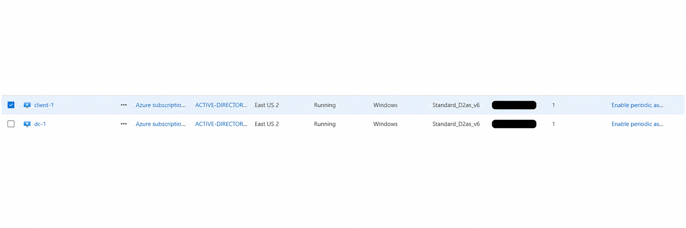

### 2. Create Shared Folders and Configure Read-Only Access

On `DC-1`, I created four folders on the `C:\` drive:

- `read-access`
- `write-access`
- `no-access`
- `accounting`

I configured the `read-access` folder as a network share and assigned the `Domain Users` security group Read permission.

This allowed standard domain users to access the shared folder without granting permission to create or modify files through the share.

**Purpose:** Read-only permissions are useful when employees need to view shared resources without changing their contents.

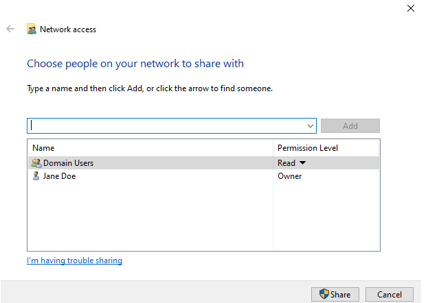

### 3. Configure Read/Write Access

I configured the `write-access` folder as a network share and assigned the `Domain Users` security group Read and Change permissions.

These permissions allowed standard domain users to read and modify content through the network share, provided the underlying NTFS permissions also allowed those actions.

**Purpose:** Read/write permissions are commonly used for shared workspaces where employees need to create, update, and manage files.

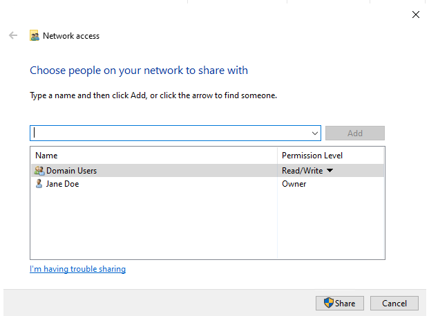

### 4. Configure Restricted Administrative Access

I configured the `no-access` folder as a network share and assigned the `Domain Admins` security group Read and Change permissions.

The share was intended to be accessible only to authorized administrators rather than standard domain users.

**Purpose:** Restricting access to administrative security groups helps protect sensitive resources from unauthorized users.

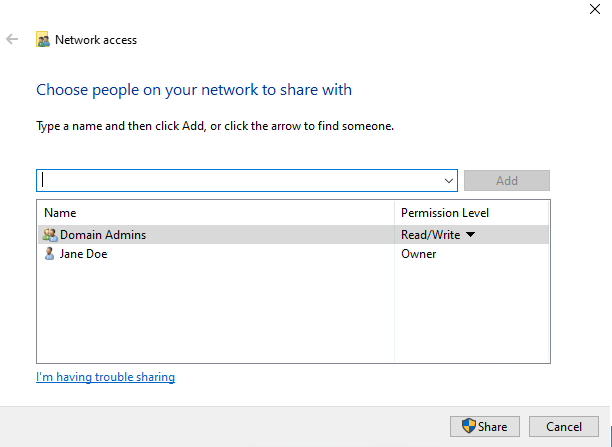

### 5. Test Read-Only Permissions

On `Client-1`, I signed in using a standard domain user account and accessed the shared folders through File Explorer.

I navigated to the read-only share:

`\\DC-1\read-access`

I attempted to create a new folder inside the share.

Windows displayed an Access Denied error because the user had Read permission but not the required write permission.

**Result:** Access to the share was allowed, but creating new content was denied.

**Purpose:** This test verified that the configured read-only access restriction was enforced.

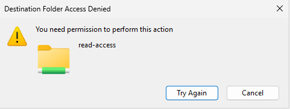

### 6. Test Read/Write Permissions

I navigated to the `write-access` share from `Client-1`:

`\\DC-1\write-access`

Using the same standard domain user account, I attempted to create a new file or folder.

The operation completed successfully.

**Result:** The user was able to create content within the shared folder.

**Purpose:** This test confirmed that the user had sufficient effective permissions to write to the network share.

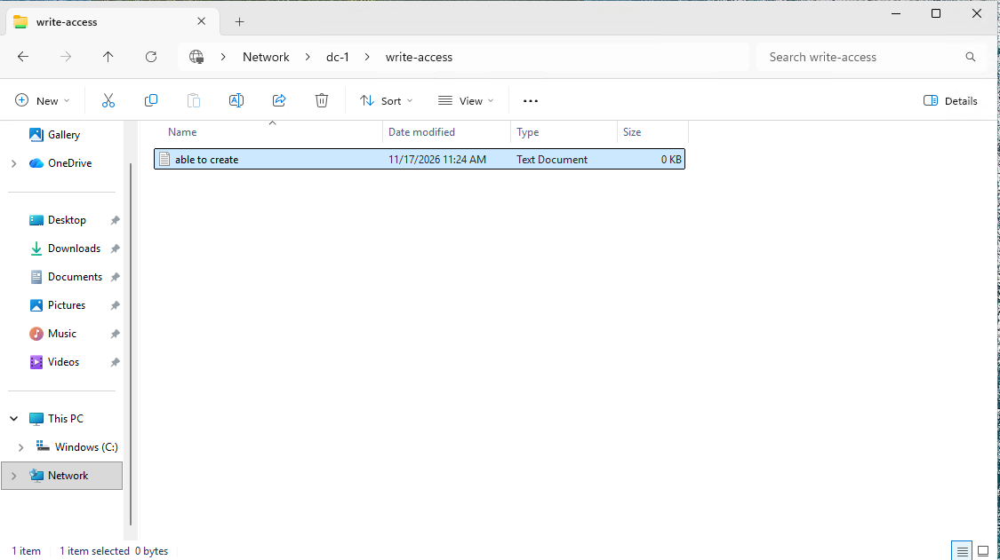

### 7. Test Restricted Folder Access

I attempted to open the restricted network share:

`\\DC-1\no-access`

Because the standard domain user was not a member of the `Domain Admins` security group, Windows denied access to the shared folder.

**Result:** Access Denied.

**Purpose:** This test demonstrated how security group membership can restrict access to network resources.

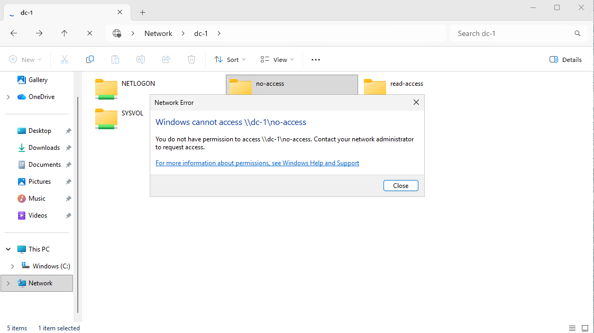

---

## Active Directory Security Group Access Management

### 8. Create the ACCOUNTANTS Security Group

On `DC-1`, I opened Active Directory Users and Computers (ADUC) and created a new security group named:

`ACCOUNTANTS`

This group was created to manage access to the accounting department's shared folder.

**Purpose:** Assigning permissions to security groups instead of individual users simplifies administration and supports role-based access control.

### 9. Configure Accounting Folder Permissions

I configured the existing `C:\accounting` folder as a network share.

I assigned the `ACCOUNTANTS` security group Read and Change permissions.

The accounting share was intended to be accessible to authorized members of the `ACCOUNTANTS` group.

**Purpose:** Department-specific security groups allow administrators to manage access to shared resources based on employees' roles and responsibilities.

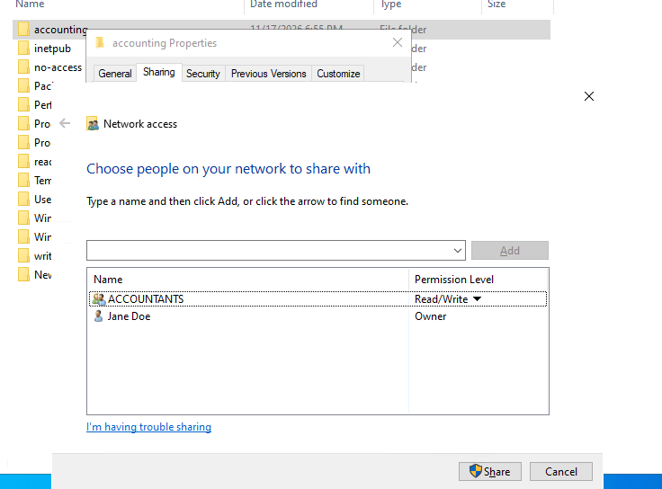

### 10. Test Accounting Access Before Group Membership

On `Client-1`, I attempted to access the accounting network share using a standard domain user account that was not a member of the `ACCOUNTANTS` security group.

I navigated to:

`\\DC-1\accounting`

Windows denied access to the shared folder.

**Result:** Access Denied.

**Purpose:** This test established that the user did not have the required permissions before being added to the authorized security group.

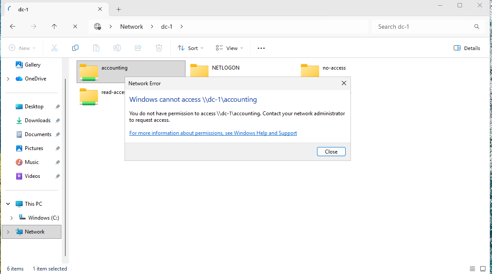

### 11. Add the User to the ACCOUNTANTS Security Group

I returned to `DC-1` and opened Active Directory Users and Computers.

I located the `ACCOUNTANTS` security group and added the standard domain user as a member.

Rather than assigning permissions directly to the individual user, I granted access through the existing security group.

**Purpose:** Managing permissions through security group membership is more scalable and easier to maintain than assigning individual permissions to every employee.

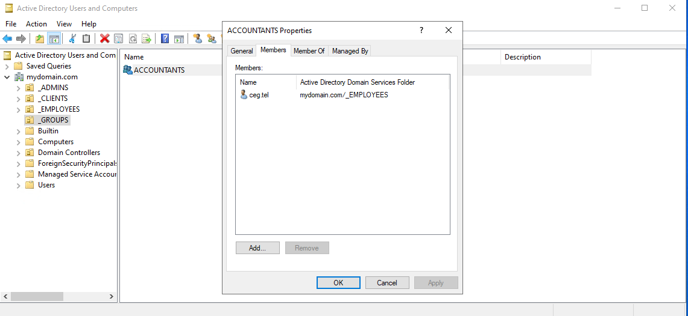

### 12. Verify Accounting Access After Group Membership

After adding the user to the `ACCOUNTANTS` security group, I signed out of `Client-1` and signed back in using the same domain user account.

I navigated to the accounting share:

`\\DC-1\accounting`

This time, I successfully accessed the folder and verified that I could read and create content.

**Result:** Access Granted — Read/Write functionality confirmed.

The new sign-in session allowed Windows to recognize the user's updated security group membership.

**Purpose:** This test demonstrated how administrators can resolve file share access issues by updating Active Directory group memberships and verifying the user's effective access.

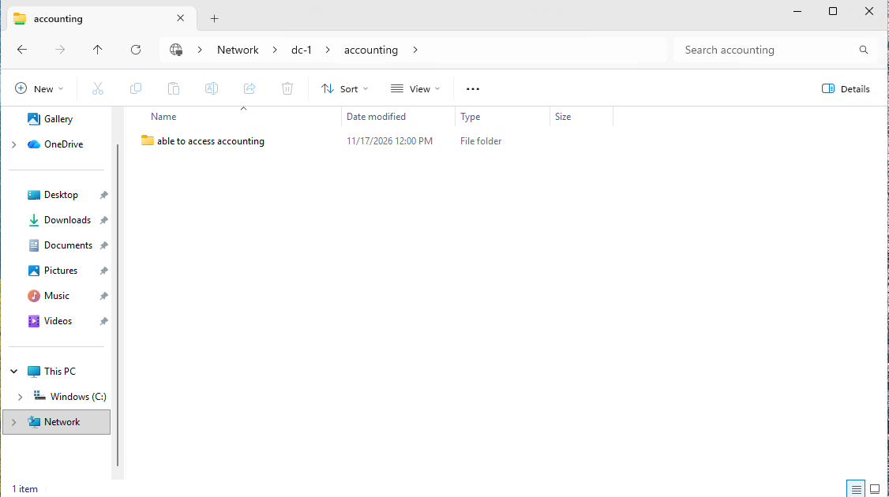

---

## Permission Testing Results

The following table summarizes the access tests performed using a standard domain user account.

| Shared Folder | Authorized Group | Share Permissions | Test Result |
|---|---|---|---|
| read-access | Domain Users | Read | Folder accessible; file creation denied |
| write-access | Domain Users | Read + Change | File creation successful |
| no-access | Domain Admins | Read + Change | Access denied |
| accounting (before) | ACCOUNTANTS | Read + Change | Access denied |
| accounting (after) | ACCOUNTANTS | Read + Change | Read/write access successful |

These tests demonstrated that network access depends on the permissions assigned to the user's security groups.

### Understanding Share Permissions vs. NTFS Permissions

Windows uses two permission systems when controlling access to files over a network.

**Share Permissions**

Share permissions control access to folders through the network using SMB.

Common share permissions include:

- **Read:** View files and folder contents.
- **Change:** Read, create, modify, and delete content.
- **Full Control:** Includes Change permissions and additional permission-management capabilities.

**NTFS Permissions**

NTFS permissions control access to files and folders at the file system level.

Common NTFS permissions include:

- Read
- Write
- Read & Execute
- Modify
- Full Control

**Important:** When accessing a folder over the network, both share and NTFS permissions apply. The effective access is limited by the permissions granted through both systems, including applicable allow and deny entries.

For example, granting Change permission at the share level does not automatically allow file creation if NTFS permissions restrict the user to Read access.

---

## Troubleshooting Scenario — Accounting Folder Access Denied

### Problem

A standard domain user attempted to access the accounting department's shared folder but received an Access Denied error.

### Investigation

I verified that the accounting folder was configured as a network share and that access was assigned to the `ACCOUNTANTS` security group.

The user was not initially a member of the group.

### Resolution

Using Active Directory Users and Computers, I added the user to the `ACCOUNTANTS` security group.

I then signed out of the client workstation and signed back in to refresh the user's authentication session.

### Verification

After signing back in, the user successfully accessed the accounting folder and created content.

### Outcome

The access issue was resolved through Active Directory security group membership management.

This scenario demonstrates a common help desk responsibility: identifying why an employee cannot access a shared resource, updating the appropriate permissions or group memberships, and verifying that access has been restored.

---

## Skills Demonstrated

- **Windows Server Administration:** Configured SMB network shares and managed folder access permissions.
- **Active Directory:** Created security groups and managed user memberships.
- **Access Control:** Tested Read, Change, and restricted access to network resources.
- **IT Troubleshooting:** Diagnosed Access Denied errors and restored access through security group membership.
- **Security:** Applied least-privilege and role-based access control concepts.

---

## Conclusion

This Network File Shares & Permissions Lab strengthened my understanding of how Windows Server, SMB file sharing, NTFS permissions, and Active Directory security groups work together to control access to shared resources.

The lab provided practical experience troubleshooting access denied errors, managing security group memberships, and verifying that users have the appropriate permissions to perform their work.

These skills are directly applicable to common IT support responsibilities in business environments.

